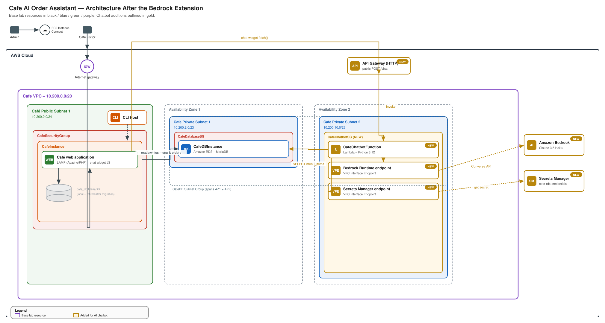

# Café AI Order Assistant — Adding Amazon Bedrock to the RDS Migration Lab

**Base project:** AWS hands-on lab "Migrate a Café Web Application to Amazon RDS" (EC2 LAMP app + MariaDB → Amazon RDS MariaDB, monitored with CloudWatch).

**This extension:** adds a serverless, Bedrock-powered chatbot to the café web app that answers customer questions about the menu, grounded in live data pulled from the RDS MariaDB instance the lab already builds.

## Why this extension

The base lab proves database migration and CLI skills. This adds four things recruiters and hiring managers look for separately:

- Generative AI integration (Amazon Bedrock, Converse API)
- Serverless architecture (Lambda, API Gateway)
- Data-grounded AI (the chatbot answers from the real `menu_items` table, not hallucinated prices)
- Private networking best practice (Bedrock and Secrets Manager reached over VPC interface endpoints, no NAT Gateway, no public Lambda)

## Architecture



*(Drawn in the same visual style as the base lab's own diagrams — purple VPC border, green public subnet, blue private subnets, red security groups. New chatbot resources are outlined in gold so they read as additions at a glance. SVG source above; a PNG copy is in `docs/architecture-with-ai.png` for tools that don't render SVG.)*

Request flow: a visitor's browser calls API Gateway directly (not through the VPC's Internet Gateway, since API Gateway is a separate managed endpoint) → API Gateway invokes the Lambda → the Lambda reads `menu_items` from the existing RDS instance and calls Bedrock over a private VPC interface endpoint → the reply streams back through API Gateway to the chat widget.

New resources added to the lab's existing `Cafe VPC (10.200.0.0/20)`:

| Resource | Purpose | Placement |
|---|---|---|
| `CafeChatbotFunction` (Lambda) | Fetches menu from RDS, calls Bedrock, returns reply | Cafe Private Subnet 1 & 2 |
| `CafeChatbotSG` (security group) | Lambda ENIs; outbound 443 + 3306 | Cafe VPC |
| Bedrock Runtime VPC interface endpoint | Private path from Lambda to Bedrock, no NAT Gateway | Cafe Private Subnet 1 & 2 |
| Secrets Manager VPC interface endpoint | Private path to read DB credentials | Cafe Private Subnet 1 & 2 |
| `cafe-rds-credentials` (Secrets Manager secret) | RDS username/password/host, read by Lambda | n/a |
| `CafeChatbotApi` (API Gateway HTTP API) | Public `/chat` endpoint the browser widget calls | n/a |
| Chat widget (HTML/JS snippet) | Embedded in the café app's existing pages | CafeInstance |

Ingress rule added to the existing `CafeDatabaseSG`: allow TCP 3306 from `CafeChatbotSG`.

## Prerequisites

1. Complete the base lab through Task 3 (data migrated to RDS) so `CafeDBInstance` and the `menu_items` table exist.
2. In the Bedrock console, request/enable model access for **Anthropic Claude 3.5 Haiku** (or your preferred Bedrock text model) in the lab's region. This is a one-time, per-account step and must be done in the console — there's no CLI shortcut for first-time access grants.
3. Note down from the base lab: `CafeVpcId`, `CafePrivateSubnet1`, `CafePrivateSubnet2`, `CafeDatabaseSG` ID, and the RDS endpoint/username/password.
4. A Lambda layer providing `pymysql` (or `PyMySQL` packaged into your deployment zip) — the standard Python 3.12 Lambda runtime doesn't include a MySQL/MariaDB client library.

## Build steps

Run these from the CLI Host instance you already used in Task 2, or any machine with AWS CLI configured for this account.

### 1. Store RDS credentials in Secrets Manager

```bash
aws secretsmanager create-secret \
  --name cafe-rds-credentials \
  --description "Credentials for Cafe RDS MariaDB instance" \
  --secret-string '{"username":"admin","password":"<rds-password>","host":"<rds-endpoint>"}'
```

### 2. Create the Lambda execution role

```bash
aws iam create-role \
  --role-name CafeChatbotLambdaRole \
  --assume-role-policy-document file://lambda/lambda-trust-policy.json

aws iam put-role-policy \
  --role-name CafeChatbotLambdaRole \
  --policy-name CafeChatbotLambdaPolicy \
  --policy-document file://iam/cafe-chatbot-lambda-policy.json
```

### 3. Create the chatbot security group and open DB access to it

```bash
CHATBOT_SG=$(aws ec2 create-security-group \
  --group-name CafeChatbotSG \
  --description "Cafe chatbot Lambda ENIs" \
  --vpc-id <CafeVpcId> \
  --query 'GroupId' --output text)

aws ec2 authorize-security-group-ingress \
  --group-id <CafeDatabaseSG> \
  --protocol tcp --port 3306 \
  --source-group $CHATBOT_SG
```

### 4. Add private connectivity to Bedrock and Secrets Manager

```bash
aws ec2 create-vpc-endpoint \
  --vpc-id <CafeVpcId> \
  --service-name com.amazonaws.<region>.bedrock-runtime \
  --vpc-endpoint-type Interface \
  --subnet-ids <CafePrivateSubnet1> <CafePrivateSubnet2> \
  --security-group-ids $CHATBOT_SG

aws ec2 create-vpc-endpoint \
  --vpc-id <CafeVpcId> \
  --service-name com.amazonaws.<region>.secretsmanager \
  --vpc-endpoint-type Interface \
  --subnet-ids <CafePrivateSubnet1> <CafePrivateSubnet2> \
  --security-group-ids $CHATBOT_SG
```

### 5. Package and deploy the Lambda function

```bash
cd lambda
pip install pymysql -t ./package --platform manylinux2014_x86_64 --only-binary=:all: --python-version 3.12
cp chatbot_handler.py ./package/
cd package && zip -r ../chatbot_handler.zip . && cd ..

aws lambda create-function \
  --function-name CafeChatbotFunction \
  --runtime python3.12 \
  --handler chatbot_handler.handler \
  --role arn:aws:iam::<ACCOUNT_ID>:role/CafeChatbotLambdaRole \
  --zip-file fileb://chatbot_handler.zip \
  --timeout 15 \
  --memory-size 256 \
  --vpc-config SubnetIds=<CafePrivateSubnet1>,<CafePrivateSubnet2>,SecurityGroupIds=$CHATBOT_SG \
  --environment "Variables={BEDROCK_MODEL_ID=anthropic.claude-3-5-haiku-20241022-v1:0,DB_SECRET_ARN=<secret-arn>}"
```

### 6. Expose it through API Gateway

```bash
API_ID=$(aws apigatewayv2 create-api \
  --name CafeChatbotApi \
  --protocol-type HTTP \
  --target arn:aws:lambda:<region>:<ACCOUNT_ID>:function:CafeChatbotFunction \
  --query 'ApiId' --output text)

aws lambda add-permission \
  --function-name CafeChatbotFunction \
  --statement-id apigateway-invoke \
  --action lambda:InvokeFunction \
  --principal apigateway.amazonaws.com \
  --source-arn "arn:aws:execute-api:<region>:<ACCOUNT_ID>:${API_ID}/*/*/chat"

aws apigatewayv2 get-apis --query "Items[?ApiId=='${API_ID}'].ApiEndpoint" --output text
```

### 7. Wire up the frontend

Open `web/chatbot-widget.html`, replace `CAFE_CHAT_API_URL` with the API Gateway endpoint from step 6 plus `/chat`, and paste the snippet into the café app's page template (near the closing `</body>` tag).

## Testing

1. Load the café web app and open the chat widget.
2. Ask: "What's on the menu and what does it cost?" — reply should list the actual items/prices from `menu_items`, not generic placeholders.
3. Ask something off-menu ("Do you deliver to Dallas?") — the assistant should decline gracefully rather than making something up; tighten the system prompt in `chatbot_handler.py` if it doesn't.
4. Check `aws logs tail /aws/lambda/CafeChatbotFunction --follow` while testing to confirm the Secrets Manager read and Bedrock call both succeed.

## Monitoring (extends the lab's CloudWatch task)

Add these alongside the RDS CloudWatch metrics from the base lab:

```bash
aws cloudwatch put-metric-alarm \
  --alarm-name CafeChatbotLambdaErrors \
  --namespace AWS/Lambda --metric-name Errors \
  --dimensions Name=FunctionName,Value=CafeChatbotFunction \
  --statistic Sum --period 300 --threshold 1 \
  --comparison-operator GreaterThanOrEqualToThreshold --evaluation-periods 1
```

Also watch Lambda `Duration` (Bedrock calls can add 1-3s of latency) and set a Bedrock usage/cost budget alert if you plan to leave this running.

## Cost notes

Pay-per-use: Bedrock charges per input/output token (Claude 3.5 Haiku is one of the cheapest models — good fit for a demo), Lambda and API Gateway have generous free tiers, and the two VPC interface endpoints run roughly $0.01/hr each plus data processing. Tear down the endpoints and Lambda when you're done recording the demo if you want to avoid the endpoint hourly charge.

## Cleanup

```bash
aws lambda delete-function --function-name CafeChatbotFunction
aws apigatewayv2 delete-api --api-id ${API_ID}
aws ec2 delete-vpc-endpoints --vpc-endpoint-ids <bedrock-endpoint-id> <secretsmanager-endpoint-id>
aws ec2 delete-security-group --group-id $CHATBOT_SG
aws secretsmanager delete-secret --secret-id cafe-rds-credentials --force-delete-without-recovery
aws iam delete-role-policy --role-name CafeChatbotLambdaRole --policy-name CafeChatbotLambdaPolicy
aws iam delete-role --role-name CafeChatbotLambdaRole
```

Then complete the base lab's own **End Lab** step as usual.

## Skills demonstrated

AWS CLI resource provisioning, Amazon Bedrock (Converse API), AWS Lambda, API Gateway (HTTP API), VPC interface endpoints, Secrets Manager, IAM least-privilege policy authoring, RDS/MariaDB querying from a serverless function, retrieval-grounded (RAG-style) prompting, CloudWatch alarms.
